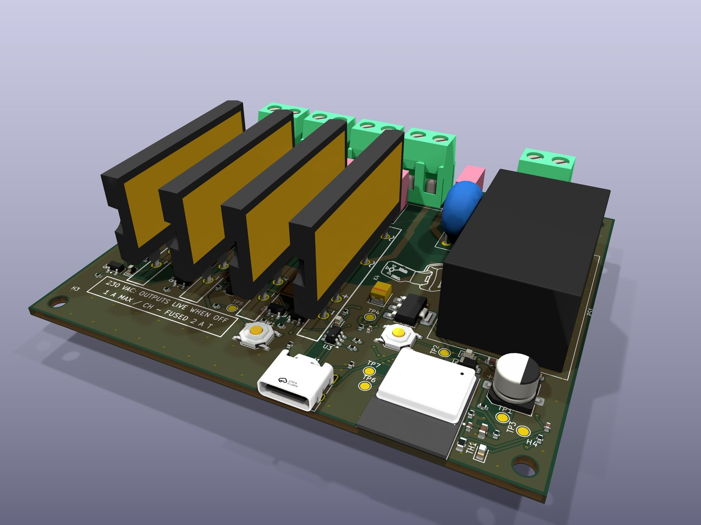
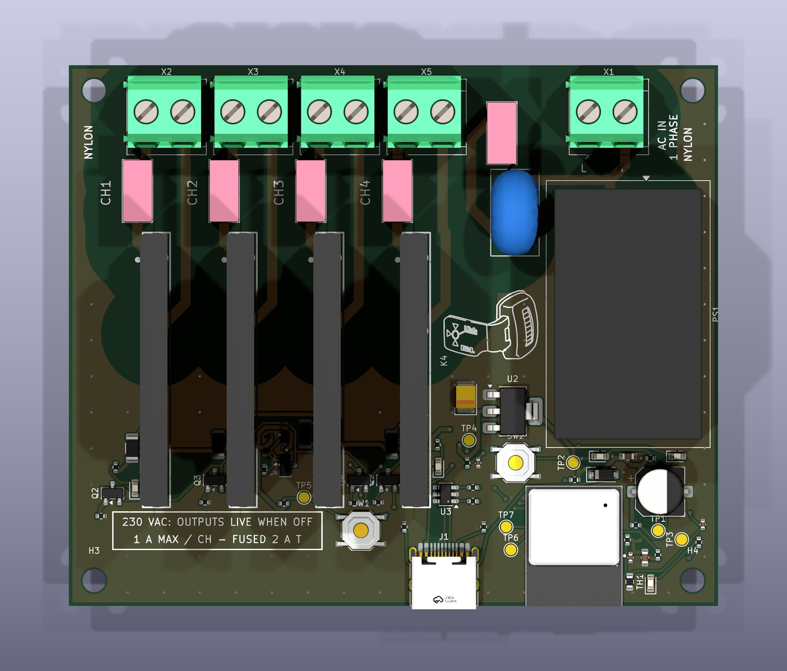
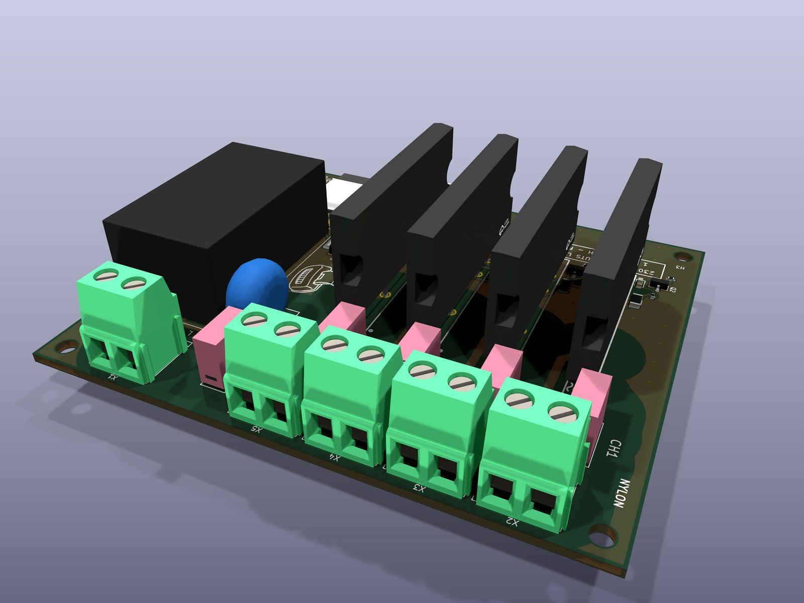
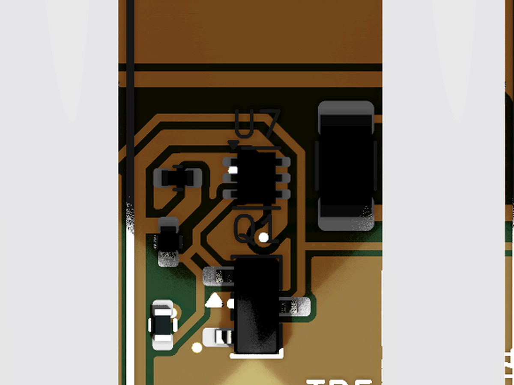
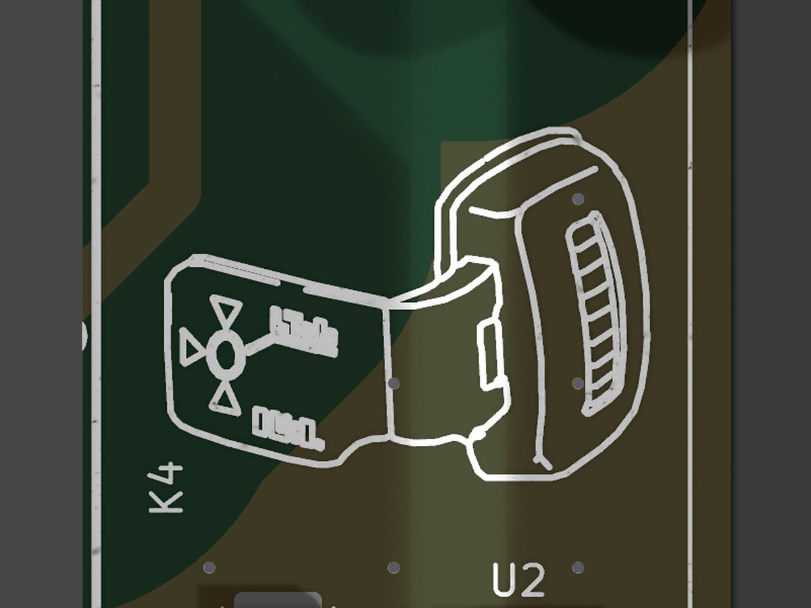

<div align="center">

# SSR4

**An open-source, four-channel 230 VAC solid-state switch for Home Assistant.**<br>
ESP32-C3 · ESPHome · zero-cross SSRs · hardware over-temperature cutoff · KiCad 10

[](LICENSES/README.md)
[](LICENSES/README.md)
[](LICENSES/README.md)
[](https://esphome.io)
[](https://www.kicad.org)
[](https://github.com/Bunty9/ssr4/actions/workflows/ci.yml)




</div>

> [!WARNING]
> **This board switches mains voltage, which can kill.** Build, test and install it only if you
> are competent to work on 230 V wiring, follow the [safety guide](docs/safety.md), and keep
> the board disconnected from mains while flashing or handling it. It is an **uncertified
> prototype design**, provided as is, without warranty.

## What it is

SSR4 turns four ordinary 230 V circuits (ceiling fans, LED lights) into Home Assistant switches.
It is small enough (90 × 75 mm) to sit in a 3D-printed case inside a wall switchboard, runs
[ESPHome](https://esphome.io) on an ESP32-C3, and works entirely on your local network.

It was designed to be **safe by construction, not by firmware**:

- **Every output turns off by itself when the board overheats.** A 60 °C temperature switch cuts
  the drive of all four SSRs in hardware, with no software in the path. The firmware adds an
  earlier 55 °C cutoff, a sensor-fault check and reporting.
- **Every output is OFF at power-up and after any reset**, enforced by gate pull-downs sized
  against the microcontroller's own reset pull-ups, before the firmware even runs, and never
  restored automatically after a power cut.
- **Mains and low voltage are 6.5 mm apart** on every layer (reinforced isolation spacing),
  checked by KiCad DRC rules shipped with the design.
- **Each channel is fused** (2 A time-lag) and has its own terminals, so the board never carries
  the sum of the loads.
- **Flash and test it from USB-C with mains disconnected**: the logic runs from USB alone.

## Gallery

| | |
|:---:|:---:|
|  |  |
| Top: mains along the upper edge, low voltage below | The terminal side: per-channel L_IN / L_OUT pairs |
|  |  |
| U7, the 60 °C hardware cutoff, sits between the SSRs | A scouter on the silkscreen: power level well over 9000 |

Full-resolution renders (4K) are in [`docs/images/`](docs/images/). The schematic and the copper
layers are in [`hardware/ssr4-schematic.pdf`](hardware/ssr4-schematic.pdf) and
[`hardware/ssr4-pcb-layers.pdf`](hardware/ssr4-pcb-layers.pdf).

## Specifications

| | |
|---|---|
| Outputs | 4 × 230 VAC, zero-cross triac SSR (Littelfuse/IXYS CPC40055ST, 20-280 Vrms, 2500 Vrms isolation) |
| Load per channel | below 1 A continuous (LED lights, fans); 2 A time-lag fuse per channel |
| Supply | 230 VAC via an isolated 5 V / 3 W module (HLK-PM01) with fuse and varistor, or USB-C 5 V for flashing |
| Controller | ESP32-C3-MINI-1 (RISC-V, Wi-Fi, 4 MB flash), native USB-C (Serial/JTAG) with ESD protection |
| Protection | hardware cutoff 60 °C ± 2 °C (TMP302, releases ~50 °C); firmware cutoff 55 °C / resume 45 °C, also latched by a hardware trip; NTC fault detection; fail-safe OFF |
| Indicators | one LED per channel, status LED |
| Board | 90 × 75 mm, 2 layers, 1.6 mm, 2 oz copper, 67 parts, four M3 holes |
| Firmware | ESPHome 2026.10 (ESP-IDF): encrypted Home Assistant API, password-protected OTA, captive-portal setup |

## From zero to switching lights

| Step | Guide |
|---|---|
| 1. Understand the board | [How it works](docs/how-it-works.md) · [Safety](docs/safety.md) |
| 2. Order it assembled (JLCPCB or PCBWay) or build it yourself | [Fabrication](docs/fabrication.md) |
| 3. Flash ESPHome over USB-C and add it to Home Assistant | [Firmware](docs/firmware.md) |
| 4. Bring it up step by step: USB, thermal checks, 24 VAC loads, first mains | [Bring-up](docs/bring-up.md) |
| 5. Wire it into a switchboard | [Installation](docs/installation.md) |
| 5b. Design a heat sink and an enclosure (STEP files included) | [Mechanical](docs/mechanical.md) |
| 6. Change it, test it, contribute | [Development](docs/development.md) · [Contributing](CONTRIBUTING.md) |

## How it has been checked

Nothing here has been built yet: rev A is a **gated, unbuilt design**. Every published file was
produced by a pipeline that refuses to release a board until its checks pass. The results of
this snapshot are in [`validation/`](validation/README.md):

| Check | Result |
|---|---|
| Datasheet pinouts: every IC, transistor, diode and connector pin extracted twice, independently, and compared | 11 parts verified, 0 disagreements left |
| Netlist tests: safety and correctness properties proved on the generated schematic | 16 passed |
| ERC | 0 errors |
| DRC, including the mains clearance and creepage rules | 0 errors, 0 unconnected (24 silkscreen warnings) |
| Fabrication rules (JLCPCB) and the order package | pass |
| Firmware behaviour on a PC simulation of the board (14 tests) | 14 passed |
| Independent design review of the final layout | 1 high and 7 medium findings: the safety-relevant ones fixed before publishing, the rest listed |
| NTC divider: closed-form design maths vs an ngspice simulation | agree within the simulator's tolerance |

Bench validation of a real board (thermal, EMC, trip points) is the next step. If you build
one, please [send a build report](https://github.com/Bunty9/ssr4/issues/new/choose).

## What it costs

About **$106 per board in parts** (5 boards, JLCPCB prices of October 2026), before PCB,
assembly and shipping. The four SSRs are $97 of that; everything else is under $9. The
[fabrication guide](docs/fabrication.md#what-it-costs) has the breakdown and a cheaper-variant
idea.

## Home Assistant

The board appears as an ESPHome device with four switches (**Channel 1-4**), the **SSR
temperature**, and three protection states: **Over-temperature**, **NTC fault** and **Hardware
over-temperature cutoff**. A channel refuses to turn on while any protection is active, so the
dashboard always shows what the hardware is really doing.

## Repository layout

```
hardware/      KiCad 10 project, libraries, circuit source (Python), fabrication files, pinouts, PDFs,
               mechanical/ (STEP assembly, board STEP, outline DXF)
firmware/      ESPHome configuration (board + PC simulation), generated pin map, tests
fwtest/        labgrid-based test harness used by the firmware tests
validation/    test results, calculations, SPICE cross-check of this snapshot
docs/          guides and full-resolution renders
```

## Contributing

Build reports, bug reports and improvements are welcome. Read [CONTRIBUTING.md](CONTRIBUTING.md)
first; safety problems go to the private channel in [SECURITY.md](SECURITY.md). This project
follows the [Contributor Covenant](CODE_OF_CONDUCT.md).

## License

- Hardware: [CERN-OHL-S-2.0](LICENSES/CERN-OHL-S-2.0.txt)
- Firmware and software: [MIT](LICENSES/MIT.txt)
- Documentation and images: [CC BY-SA 4.0](LICENSES/CC-BY-SA-4.0.txt)

Details and credits (including the scouter doodle, after fan art by camarinox; Dragon Ball ©
Bird Studio/Shueisha, Toei Animation) in [LICENSES/README.md](LICENSES/README.md).

<sub>Published from source commit `4ecfc79` on 2026-10-29.</sub>
