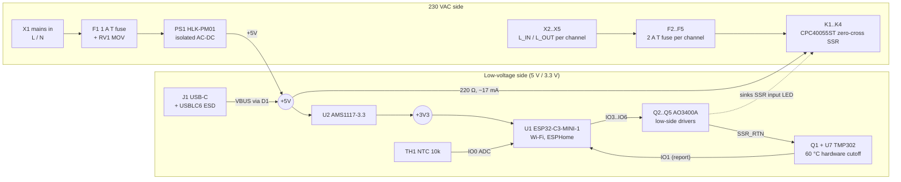

# How SSR4 works

SSR4 is a 90 × 75 mm, two-layer board that switches four 230 VAC loads (fans, LED lights) from
Home Assistant. It is split into a **mains side** (top of the board: terminals, fuses, SSR outputs,
the AC-DC module) and a **low-voltage side** (bottom: ESP32-C3, USB-C, drivers, LEDs, sensors),
separated by at least 6.5 mm of bare board everywhere.



## Power

| Rail | Source | Notes |
|---|---|---|
| Mains in | X1 (L, N) | Only the AC-DC module draws from it, through **F1** (1 A time-lag, Littelfuse 392) and **RV1** (10D561K varistor), as the HLK-PM01 datasheet asks (p12). |
| +5V | **PS1** HLK-PM01 (5 V, 3 W, isolated) **or** USB-C VBUS through Schottky **D1** | The diode-OR lets you flash and test the whole logic side from USB with mains disconnected. +5V feeds the SSR inputs and the regulator. |
| +3V3 | **U2** AMS1117-3.3, 22 µF tantalum output capacitor (the regulator's datasheet asks for it, p4) | ESP32-C3 module, NTC divider, thermal switch. |

## One output channel

Each of the four channels is the same block, repeated:

```
+5V ──220 Ω (1206)──► SSR +LED (pin 3)    SSR −LED (pin 4) ──┐
+5V ──2 kΩ──► channel LED ───────────────────────────────────┴── DRV ── Q drain
GPIO (IO3..IO6) ── Q gate (AO3400A), 2 kΩ to GND                  Q source ── SSR_RTN
L_IN (terminal) ── 2 A T fuse ── SSR pin 1 (AC)    SSR pin 2 (AC) ── L_OUT (terminal)
```

- **The SSR** (Littelfuse/IXYS CPC40055ST) is an opto-isolated, **zero-cross triac** relay rated
  20-280 Vrms, 2500 Vrms input-to-output isolation. Zero-cross switching turns loads on near
  0 V, which is kind to LED drivers and fan capacitors.
- **Input current**: 220 Ω from 5 V gives **15.9-18.6 mA** through the SSR's LED (LED Vf
  0.9-1.5 V), **14.8-19.8 mA** over a ±5 % supply. The SSR needs 5 mA to turn on and recommends
  10 mA (CPC40055ST p2). The 1206 resistor dissipates at most ~85 mW of its 250 mW rating.
- **Driver**: the AO3400A N-MOSFET (RDS(on) < 48 mΩ at VGS = 2.5 V, datasheet p2) drops about
  1 mV. Its **2 kΩ gate pull-down holds every SSR off** while the ESP32 boots or resets, before
  firmware runs. It is deliberately strong: the ESP32-C3's GPIO6 (CH4) comes out of reset with
  an internal 45 kΩ pull-up (ESP32-C3 datasheet p16-17, p55), which would lift a 100 kΩ
  pull-down to 2.3 V and switch CH4 on at every reset. With 2 kΩ the gate stays at 0.14 V,
  against the MOSFET's 0.65 V minimum threshold; a netlist test checks this for every channel.
- **Indicator**: a second LED branch in parallel shows the *commanded* state of each channel at
  about 1.7 mA.
- **Each channel has its own fuse and its own pair of terminals**: the board switches the live
  of each load; load neutrals never pass through it, and the board never carries the sum of all
  four loads.

## Two layers of over-temperature protection

| Layer | How | Trips | Releases | Depends on firmware? |
|---|---|---|---|---|
| **Hardware cutoff** | **U7** TMP302A temperature switch between K2 and K3. At 60 °C its open-drain output pulls the gate of **Q1** low; Q1 is in the **common return (SSR_RTN) of all four channel drivers**, so every SSR loses its input current at once. | 60 °C ± 2 °C (TMP302 p5, p7) | ~50 °C (10 °C hysteresis) | **No** |
| **Firmware cutoff** | **TH1** 10 kΩ NTC (B 3950) on the low-voltage side near the ESP32 module, read on IO0 (it reads board temperature, not the SSRs directly; moving it between the SSRs is planned for rev B); ESPHome switches all channels off and refuses ON. A hardware trip also sets this latch, so loads stay off until the NTC reads 45 °C. | 55 °C | 45 °C | Yes |
| **Sensor fault** | NTC node voltage outside 0.166-2.5 V (open or shorted NTC, or above the ADC's specified range): all off, ON refused. | at once | when the reading is valid again | Yes |

The hardware cutoff is the protection; the firmware cutoff trips earlier and reports what is
happening. Firmware reads the cutoff on **IO1** through 2 kΩ, so it can see it but cannot
override it: the MOSFET gate sits on the thermal switch's side of that resistor. If +3V3 fails,
the cutoff's gate falls and the outputs go off. The 60 °C point matches the AC-DC module's 60 °C
ambient rating (HLK-PM01 p9), the lowest-rated part in the enclosure.

## Microcontroller and USB

- **U1 ESP32-C3-MINI-1-H4X**: RISC-V, Wi-Fi, 4 MB flash, PCB antenna placed at the board edge with
  a copper keep-out.
- **Strapping pins** are handled in hardware: IO9 (BOOT button) and IO8/IO2 pulled up; EN has an
  RC delay and the RESET button. No output channel uses a strapping pin or IO18 (it glitches
  high at boot).
- **USB-C (J1)** goes straight to the C3's built-in USB Serial/JTAG (flashing, logs, debugging):
  22 Ω series resistors, **U3** USBLC6-2 ESD protection, 5.1 kΩ CC pull-downs (a 5 V sink).

### Pin map

Generated from the netlist (`firmware/pins.yaml`, `firmware/contract.json`); the firmware never
types a GPIO number.

| Signal | GPIO | Direction | Active | Hardware |
|---|---|---|---|---|
| ch1 / ch2 / ch3 / ch4 | GPIO3 / 4 / 5 / 6 | output | high | AO3400A gate, 2 kΩ pull-down (OFF at reset, even against GPIO6's reset pull-up) |
| ntc | GPIO0 | ADC1 | - | 10 kΩ / NTC divider, 100 nF |
| status_led | GPIO10 | output | high | status LED |
| hw_overtemp | GPIO1 | input | low | TMP302 output through 2 kΩ |
| boot | GPIO9 | input | low | BOOT button (strapping pin) |

### Test pads

| Pad | Net | Use |
|---|---|---|
| TP1 | +5V | supply check |
| TP2 | +3V3 | supply check |
| TP3 | GND | probe ground |
| TP4 | EN | reset |
| TP5 | BOOT (IO9) | download mode |
| TP6 / TP7 | UART TX / RX | serial logs without USB |

## Mains isolation and spacing

Enforced by KiCad DRC rules shipped with the board (`hardware/kicad/ssr4/circuit.kicad_dru`):

| Between | Clearance | Creepage | Basis |
|---|---|---|---|
| Mains and low-voltage (reinforced) | 6.5 mm | 6.5 mm | IEC 60664-1 / IEC 62368-1 guidance, pollution degree 2, FR4 (material group IIIa), OVC II; the stricter of two published figures, rounded up |
| Mains and mains (basic) | 1.8 mm | 2.5 mm | same |

Mains tracks are 1.4 mm wide on 2 oz copper (sized for 5 A peak at a 20 °C rise; the loads are
below 1 A continuous). See [safety.md](safety.md) for what these rules do *not* cover.

## Firmware structure

```
firmware/
  ssr4.yaml              the real board  = pins + packages/logic.yaml + packages/hw_esp32.yaml
  sim.yaml               PC simulation   = pins + packages/logic.yaml + packages/sim_host.yaml
  pins.yaml              GPIO numbers, generated from the netlist
  packages/logic.yaml    channels, interlocks, thermal logic (shared by both builds)
  packages/hw_esp32.yaml ESP32-C3, Wi-Fi, OTA, ADC, hardware-cutoff input
  packages/sim_host.yaml Linux build with test-only inputs (NTC voltage, cutoff)
  tests/                 behaviour tests that drive either build over the ESPHome API
```

The same `logic.yaml` runs on the board and on your PC, so the safety behaviour is tested
without hardware. See [firmware.md](firmware.md) and [../validation/README.md](../validation/README.md).
